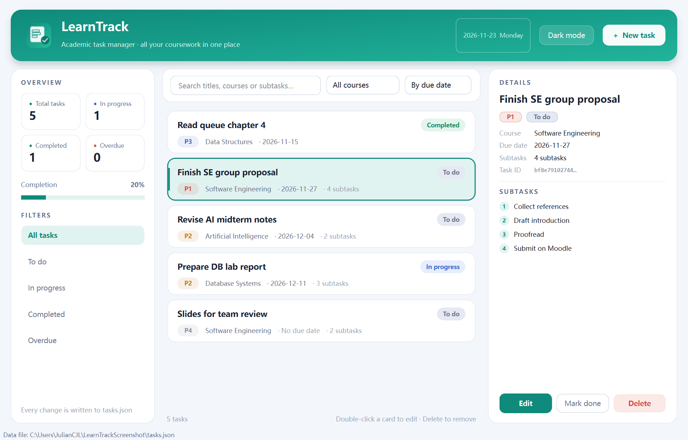

# LearnTrack — Personal Learning Task Manager

LearnTrack is a lightweight desktop application, built with PySide6, that helps
university students keep all coursework tasks in one place; a command-line
companion ships in the same folder. It records task titles, courses, due dates,
priorities, progress status, and subtasks; supports listing, filtering, sorting,
searching, and progress statistics; and persists the data to a local JSON file.
The interface, source code, and documentation are in English throughout.



*A sample board: summary cards on the left, task cards with priority and status
chips in the middle, and the selected task's detail and subtask list on the
right.*

## 1. Background and goals

Students receive assignment deadlines scattered across different courses, group
chats, and platforms, so small tasks are easily forgotten until the deadline is
imminent. Long-term assignments such as term papers usually have only one distant
deadline, which makes it hard to break the work into smaller steps and monitor
progress.

The prototype targets the following goals:

- Provide a single place to view upcoming coursework deadlines.
- Allow long assignments to be decomposed into subtasks.
- Show progress by status and summarize completion.
- Order and highlight work by priority and overdue state.
- Stay lightweight and student-friendly, with no third-party dependencies.

## 2. Features

- **Task management:** add, view, list, update, and delete tasks.
- **Desktop board:** summary cards, a card list with priority and status chips,
  a detail pane with the full subtask list, and in-app search, sorting, and
  filtering; a light/dark theme switch is included.
- **Task fields:** title, course, due date (`YYYY-MM-DD`, optional), priority
  (1 highest – 4 lowest), status (`To Do`, `In Progress`, `Completed`), and a
  subtask list.
- **List ordering:** deadlines ascending, undated tasks last, then priority,
  then task ID. The desktop UI can re-sort by priority, course, or title.
- **Filters:** exact course match, exact status match, and overdue-only view;
  filters combine with AND.
- **Search:** the desktop UI searches titles, courses, and subtask text
  case-insensitively as you type.
- **Statistics:** total tasks, counts by status, overdue count, and completion
  rate; the desktop UI also draws a completion bar.
- **Subtask input:** subtasks are split on ASCII/full-width commas, ideographic
  commas, and semicolons.
- **Local persistence:** tasks are stored in `tasks.json` next to the program
  and survive restarts.
- **Input validation:** invalid input is rejected with a message and the prompt
  repeats; `ValueError` errors from the task layer are shown as action errors
  instead of terminating the interface. The desktop dialog validates the form
  before saving and reports write failures without pretending they succeeded.

## 3. Architecture

The program follows a layered design. Each layer depends only on the layer
below it; neither interface manipulates task data or files directly.

| Module | Responsibility |
|---|---|
| `task.py` | Task entity, field validation, and dictionary/JSON serialization. |
| `task_manager.py` | In-memory business layer: CRUD, ordering, filtering, and statistics. Returns independent snapshots so callers cannot corrupt the store. |
| `json_storage.py` | JSON persistence: load and save tasks, corruption recovery, backup copies, and the storage-backed manager. |
| `ui_theme.py` | Colour palettes, the Qt stylesheet, and generated icon/caret assets. |
| `ui_widgets.py` | Task list model, card delegate, summary cards, toast, empty state, and the task dialog. |
| `learntrack_ui.py` | Desktop entry point: window layout, filters, search, sorting, theme switching, and shortcuts. |
| `learntrack_cli.py` | Menu and input validation. Delegates all task operations to the manager through the `TaskManagerPort` / `TaskRecord` interface. |
| `verify_bug_fixes.py` | Self-contained regression checks for the storage layer and CLI flows. |

### Data model

| Field | Type | Rules |
|---|---|---|
| `task_id` | string | Generated by the manager as a 32-character hexadecimal ID; cannot be changed. |
| `title` | string | Non-empty. |
| `course` | string | Non-empty. |
| `due_date` | string | `YYYY-MM-DD`, or an empty string when there is no deadline. |
| `priority` | integer | 1 to 4; 1 is highest. |
| `status` | string | `To Do`, `In Progress`, or `Completed`. |
| `subtasks` | list of strings | May be empty. |

## 4. Running the program

- **Requirements:** Python 3.10 or later. The CLI and storage layers use the
  standard library only; the desktop UI additionally needs PySide6
  (`pip install PySide6`), and rebuilding the executable needs PyInstaller.
- **Desktop application (recommended):** double-click `LearnTrack.exe`. The
  window opens without a console. `tasks.json` is kept next to the executable;
  if that folder is read-only, the program falls back to
  `%USERPROFILE%\LearnTrack\tasks.json` and shows the active path in the status
  bar.
- **Desktop UI from source:**

  ```bash
  python learntrack_ui.py
  ```

- **Windows CLI launcher:** double-click `StartLearnTrack.bat`. The launcher runs
  the program from its own folder so `tasks.json` is created next to the code,
  and keeps the window open after exit.
- **Command line:**

  ```bash
  python learntrack_cli.py
  ```

### Moving the program between computers

The shipped `LearnTrack.exe` is a single self-contained Windows executable: the
icon, stylesheet, and drag handles are bundled inside it, so the project folder
can be zipped and unpacked anywhere on Windows without reinstalling Python or
PySide6.

- Extract the archive to any **writable** folder, for example `Documents`,
  `Desktop`, or a dedicated course folder. Avoid read-only locations such as
  `C:\Program Files` or `C:\Windows`.
- Paths may contain spaces. Keep the archive name and folder names in English to
  avoid encoding problems in some unzip tools.
- On first launch Windows may show a SmartScreen warning because the executable
  is not code-signed; choose *More info → Run anyway*.
- Task data follows the executable: `tasks.json` is created beside it, and when
  that folder cannot be written the program stores its data under
  `%USERPROFILE%\LearnTrack\tasks.json` instead, showing the active path in the
  status bar.
- The executable is built for Windows only. It does not run on macOS or Linux;
  on those systems use `python learntrack_ui.py` from the same folder.

### Desktop shortcuts

| Shortcut | Action |
|---|---|
| `Ctrl+N` | Create a task |
| `Ctrl+F` | Focus the search box |
| `Ctrl+R` | Reload `tasks.json` from disk |
| `F2` / double-click | Edit the selected task |
| `Delete` | Delete the selected task (ignored while typing in a text field) |

### Building the executable

Double-click `build_exe.bat`; it calls PyInstaller with the same options used for
the shipped build (one file, windowed, icon and assets bundled) and writes
`LearnTrack.exe` into this folder. The equivalent command is:

```bash
python -m PyInstaller --onefile --windowed --name LearnTrack \
  --icon assets/learn_track.ico --add-data "assets;assets" \
  learntrack_ui.py
```

### Menu reference

| Option | Action |
|---|---|
| 1 | Add task |
| 2 | List tasks |
| 3 | View task details |
| 4 | Update task |
| 5 | Delete task |
| 6 | Filter tasks |
| 7 | View statistics |
| 0 | Exit |

On the task ID prompt, enter `0` to return to the main menu.

## 5. Validation and error handling

- Menu choices must match one of the displayed options.
- Titles and course names cannot be blank.
- Due dates must be valid calendar dates in `YYYY-MM-DD` form; the field may
  be left blank when no deadline is known.
- Priority must be an integer from 1 to 4.
- Status is chosen from the three documented values.
- When an input is invalid, the CLI explains the expected format and asks
  again. End-of-file and keyboard interruption close the CLI cleanly.

## 6. Storage and data safety

- **Atomic writes:** saving uses a temporary file, flush, `fsync`, and atomic
  replacement, so an interrupted write cannot corrupt the original file.
- **Missing file:** a missing `tasks.json` is created as an empty list.
- **Encoding:** files with a UTF-8 BOM are decoded normally.
- **Damaged files:** unreadable, non-UTF-8, or non-list files are copied beside
  the original as `tasks_corrupt_*.json` before an empty list is rebuilt. If
  the backup cannot be written, the rebuild is abandoned and an `OSError` is
  raised instead of destroying the only data copy.
- **Invalid records:** records that fail validation or duplicate an existing
  task ID are skipped. The original file is backed up as `tasks_skipped_*.json`
  before the next save, so dropped records can be recovered manually.
- **Concurrent instances:** if another instance changed the file, the on-disk
  version is preserved as `tasks_conflict_*.json` before this instance writes
  its snapshot, and the `external_change` flag is set.
- **Save failure:** when a save cannot complete, the change is kept in memory,
  the `last_save_failed` flag is set, and the CLI reports that the change was
  not persisted.

## 7. Testing

- **Regression script:**

  ```bash
  python verify_bug_fixes.py
  ```

  Runs seven checks in temporary directories; exit code 0 means all passed,
  1 means at least one failed.

- **Storage self-test:**

  ```bash
  python json_storage.py
  ```

  Exercises loading, saving, reopening, corruption recovery, skipped records,
  BOM tolerance, and concurrent-instance backup.

- **Unit and integration suite:** 174 cases covering the task entity, the
  business layer, the storage layer, and whole-menu CLI flows, including
  normal, illegal, and boundary input.

## 8. Known limitations and future work

- No calendar or desktop notifications, and no recurring deadlines.
- There is no multi-user mode or true merge of concurrent writes; the other
  instance's version is preserved as a conflict snapshot instead of being
  merged.
- The CLI filters are exact, case-sensitive matches. The desktop UI adds
  case-insensitive search over titles, courses, and subtasks, but its course and
  status filters remain exact.
- Tasks are identified by a 32-character hexadecimal ID; short serial-number
  selection could be added to simplify manual entry.
- This is a single-user local prototype, with no authentication or cloud sync.

## 9. References

[1] R. X. Bi, S. Cheng, and K. Y. Liu, "Nearly 40% of college students
dissatisfied with personal time management," *China Youth Daily*, Aug. 17,
2020. [Online]. Available:
https://edu.people.com.cn/BIG5/n1/2020/0817/c1053-31824530.html

[2] Todoist Help Center, "Get started with Todoist." [Online]. Available:
https://www.todoist.com/help/todoist/get-started/get-started-with-todoist-OgNNJR

[3] Todoist Help Center, "Introduction to filters." [Online]. Available:
https://www.todoist.com/help/todoist/features/introduction-to-filters-V98wIH

[4] Microsoft Support, "Add due dates and reminders in Microsoft To Do."
[Online]. Available:
https://support.microsoft.com/en-us/todo/add-due-dates-and-reminders-in-microsoft-to-do

[5] Microsoft Support, "Plan and connect with Microsoft To Do." [Online].
Available:
https://support.microsoft.com/en-us/todo/plan-and-connect-with-microsoft-to-do

[6] Microsoft Support, "Sort and search in lists." [Online]. Available:
https://support.microsoft.com/en-us/todo/sort-and-search-in-lists

[7] Microsoft Support, "Use Microsoft To Do for tasks and reminders in Outlook
on the web." [Online]. Available:
https://support.microsoft.com/en-us/office/use-microsoft-to-do-for-tasks-and-reminders-in-outlook-on-the-web-dadc98aa-d854-4ecf-8433-e8dd5d55df6c
